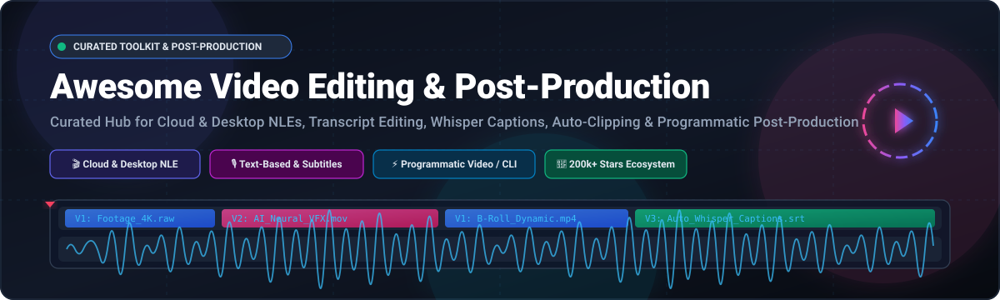

# 🎬 Awesome Video Editing Toolkit & Post-Production

  
  
  
  
  

**Curated list of professional SaaS products, cloud video platforms, and open-source GitHub projects for video editing, transcript-driven cutting, Whisper subtitles, silence removal, AI viral clip repurposing, and programmatic post-production workflows.**

*Last updated: November 2026*

---

## 📑 Table of Contents

- [📊 Sector Overview & Market Dynamics](#-sector-overview--market-dynamics)
- [💼 SaaS & Commercial Cloud Platforms](#-saas--commercial-cloud-platforms)
- [🛠️ Open-Source GitHub Projects](#️-open-source-github-projects)
- [📈 Star History](#-star-history)
- [🤝 How to Contribute](#-how-to-contribute)
- [💖 Support](#-support)
- [⚖️ Disclaimer](#️-disclaimer)

---

## 📊 Sector Overview & Market Dynamics

> The global video editing software and post-production market is estimated at **$3.6 billion to $4.2 billion in 2026**, expanding at a robust **6.8% CAGR** driven by the exponential creator economy, social video proliferation (YouTube Shorts, TikTok, Reels), and the rapid infusion of multimodal generative AI and automated speech models (Whisper).
>
> The sector displays **moderate fragmentation with tier-based concentration**: legacy Hollywood and professional broadcast suites remain concentrated under entrenched incumbents (Adobe Premiere / Frame.io, Blackmagic DaVinci Resolve, Apple Final Cut Pro), whereas the cloud-native, browser-based, AI-native clipping and programmatic post-production layer is highly competitive and dynamic, where emerging winners (Descript, VEED.IO, Kapwing, OpusClip) compete with high-velocity open-source frameworks for developer and creator mindshare.

---

## 💼 SaaS & Commercial Cloud Platforms

The table below ranks prominent commercial video editing and AI-powered post-production platforms by company scale (market cap / valuation / estimated ARR), complete with specific entry tier pricing and exact free tier limits:

| Platform | Estimated Scale / Valuation | Key Post-Production Focus | Specific Starting Price | Specific Free Tier Limit |
| :--- | :--- | :--- | :--- | :--- |
| **[Microsoft Clipchamp](https://clipchamp.com)** | **$3.1T** *(Parent Market Cap)* | Browser & Windows multi-track timeline NLE, text-to-speech voiceovers, auto-captions | **$11.99/mo** (Premium plan billed monthly, or $9.99/mo annual) | **Free forever**: unlimited watermark-free 1080p video exports, basic filters, free audio/video stock |
| **[Adobe Premiere Pro & Frame.io Web](https://adobe.com)** | **$210B+** *(Adobe Market Cap)* | Broadcast NLE standard, text-based transcript cutting, AI speech enhancement, Frame.io cloud collaboration | **$22.99/mo** (Premiere Pro single app plan billed monthly) | **7-day free trial** with full access to Premiere Pro and Frame.io Cloud (requires CC signup, cancel within 7 days) |
| **[Runway Video Editor](https://runwayml.com)** | **$1.5B+** *(Valuation)* | Browser generative NLE, rotoscoping, Gen-2/Gen-3 Alpha generative fill, multi-track timeline | **$12/mo** (Standard plan billed annually at $144/yr, or $15/mo monthly) | **Free forever**: 125 one-time generation credits, 3 video projects, 5GB cloud storage, 720p video exports |
| **[Descript](https://descript.com)** | **$550M+** *(Valuation)* | Text-based editing, Underlord AI assistant, Studio Sound speech cleanup, Overdub voice cloning | **$12/mo** (Hobbyist plan billed annually at $144/yr, or $19/mo monthly) | **Free forever**: 1 transcription hour/month, 720p watermark-free exports (1/mo), 1-min Studio Sound clips |
| **[Kapwing](https://kapwing.com)** | **$150M+** *(Valuation)* | Cloud collaborative NLE, Smart Cut silence trimmer, auto-subtitling, aspect-ratio reframing | **$16/mo** (Pro plan billed annually at $192/yr, or $24/mo monthly) | **Free forever**: export videos up to 7 minutes with Kapwing watermark, 3 subtitle exports/month up to 720p |
| **[VEED.IO](https://veed.io)** | **$100M+ ARR** *(Scale)* | Browser AI editing studio, dynamic animated karaoke captions, eye-contact fix, AI dubbing | **$12/user/mo** (Basic plan billed annually at $144/yr, or $18/user/mo monthly) | **Free forever**: 10 min transcription/month, 720p exports with VEED watermark, 2GB cloud upload limit |
| **[InVideo AI](https://invideo.io)** | **$60M+** *(Valuation / Scale)* | Script-to-video generator, automated stock B-roll insertion, voiceovers, text-guided revision | **$20/mo** (Plus plan billed annually at $240/yr, or $25/mo monthly) | **Free forever**: 10 mins/week AI video generation with watermark, 10GB storage, 4 exports/week |
| **[Riverside.fm](https://riverside.fm)** | **$50M+** *(Valuation)* | Studio-quality uncompressed 4K local recording, transcript-based cutting, Magic Clips highlights | **$15/mo** (Standard plan billed annually at $180/yr, or $19/mo monthly) | **Free forever**: 2 hours of separate audio/video recording tracks, unlimited 720p exports with watermark |
| **[OpusClip](https://opus.pro)** | **$45M+** *(Valuation)* | AI repurposing engine: long-form video to viral vertical short clips, speaker detection, autotitles | **$9.50/mo** (Starter plan billed annually at $114/yr, or $19/mo monthly) | **Free forever**: 60 free processing minutes on signup, 30 minutes/month renewed, 1080p exports with watermark |
| **[WeVideo](https://wevideo.com)** | **$30M+ ARR** *(Scale)* | Cloud timeline editor, screen recording, collaborative project bins for business and education | **$4.99/mo** (Power plan billed annually at $59.88/yr, or $9.99/mo monthly) | **Free forever**: 5 minutes/month video publishing time, 1GB cloud storage, 480p resolution with watermark |
| **[FlexClip](https://flexclip.com)** | **$10M+ ARR** *(Scale)* | Drag-and-drop web video editor, stock templates, automated captioning, text-to-speech engine | **$9.99/mo** (Plus plan billed annually at $119.88/yr, or $19.99/mo monthly) | **Free forever**: 1 stock video/audio per project, 720p SD downloads, max 12 projects, 1 min video length |

---

## 🛠️ Open-Source GitHub Projects

The open-source video editing and post-production ecosystem is sorted below strictly by GitHub stargazer popularity. Every repository features an official live social star badge linking directly to its stargazers:

1. **[yt-dlp](https://github.com/yt-dlp/yt-dlp)**   
   The gold standard command-line multimedia downloader and pre-production ingest tool, extracting audio, video, subtitles, chapters, and metadata for editing pipelines across thousands of web platforms.

2. **[MoneyPrinterTurbo](https://github.com/harry0703/MoneyPrinterTurbo)**   
   Complete automated short-form video generation engine that transforms a prompt or topic into HD vertical videos complete with scriptwriting, B-roll synthesis, voiceover narration, background music, and styled subtitles.

3. **[OpenCut](https://github.com/OpenCut-app/OpenCut)**   
   Modern, open-source privacy-focused web and desktop alternative to CapCut, featuring full multi-track timeline editing, client-side rendering, and customizable asset libraries without telemetry.

4. **[OBS Studio](https://github.com/obsproject/obs-studio)**   
   The world's leading open-source software for live video recording, multi-track audio routing, virtual camera outputs, scene compositing, and professional post-production master capture.

5. **[Remotion](https://github.com/remotion-dev/remotion)**   
   Premier framework for creating video programmatically using React, TypeScript, and CSS, enabling dynamic video rendering pipelines, animated subtitles, customized motion graphics, and automated video SaaS architectures.

6. **[FFmpeg](https://github.com/FFmpeg/FFmpeg)**   
   The universal multimedia backbone powering almost every modern video editor, transcoder, subtitle renderer, and post-production pipeline on Earth.

7. **[LosslessCut](https://github.com/mifi/lossless-cut)**   
   The definitive Swiss army knife for lossless video and audio editing—ultra-fast GUI for cutting, trimming, merging, and extracting streams without re-encoding quality degradation.

8. **[Manim](https://github.com/ManimCommunity/manim)**   
   Community-maintained Python engine for programmatic mathematical animations and dynamic technical visual explainer videos, originally developed by 3Blue1Brown.

9. **[Uppy](https://github.com/transloadit/uppy)**   
   Modular open-source client-side file and video uploader for web browsers, offering seamless resumable video uploads (Tus protocol), webcam recording, and cloud post-production ingest.

10. **[Ultimate Vocal Remover GUI](https://github.com/Anjok07/ultimatevocalremovergui)**   
    State-of-the-art deep neural network GUI for audio post-production: isolates vocal stems, background noise, instrumental tracks, and dialog for pristine audio clarity.

11. **[WhisperX](https://github.com/m-bain/whisperX)**   
    High-performance speech-to-text pipeline offering phoneme-level forced alignment, word-level timestamps, and speaker diarization for frame-accurate video cut points and dynamic captions.

12. **[Cap](https://github.com/CapSoftware/Cap)**   
    Open-source Loom and Screen Studio alternative for instant screen recording, automatic cursor smoothing, zoom animations, dynamic backgrounds, and quick editing.

13. **[HandBrake](https://github.com/HandBrake/HandBrake)**   
    Indispensable open-source multithreaded video transcoder for converting video masters into web-ready formats (AV1, H.264, H.265) with hardware acceleration.

14. **[Buzz](https://github.com/chidiwilliams/buzz)**   
    Offline speech recognition and subtitle generator running Whisper locally on desktop to transcribe, translate, and export SRT/VTT caption files without cloud servers.

15. **[Blender Video Sequence Editor (VSE)](https://github.com/blender/blender)**   
    Complete built-in non-linear video editing timeline and compositor inside Blender, supporting multi-track audio/video cutting, color grading, and 3D visual effects integration.

16. **[Motion Canvas](https://github.com/motion-canvas/motion-canvas)**   
    TypeScript-based programmatic motion graphics framework with an interactive browser preview editor designed for crafting precise visual explanations and synchronized animations.

17. **[VideoLingo / Open-Dubbing](https://github.com/Huanshere/VideoLingo)**   
    Comprehensive automated video localization suite providing Netflix-standard subtitle segmentation, multi-agent LLM translation, WhisperX word alignment, and personalized voice cloning dubbing.

18. **[Shotcut](https://github.com/mltframework/shotcut)**   
    Mature cross-platform open-source video editor built on the MLT Multimedia Framework, supporting 4K multi-format timelines, three-point editing, color grading, and audio scopes.

19. **[MoviePy](https://github.com/Zulko/moviepy)**   
    Popular Python library for programmatic video editing, cuts, text overlays, compositing, title rendering, and automated batch video processing.

20. **[Subtitle Edit](https://github.com/SubtitleEdit/subtitleedit)**   
    Feature-complete subtitle workshop supporting audio waveform visualization, offline Whisper transcription, automatic sync, machine translation, and 300+ subtitle format conversions.

21. **[ffmpeg-python](https://github.com/kkroening/ffmpeg-python)**   
    Idiomatic Python wrapper for FFmpeg with complex filter-graph support, allowing fluent chaining of video scale, overlay, concatenate, and audio filters.

22. **[Olive Video Editor](https://github.com/olive-editor/olive)**   
    Modern open-source non-linear video editor engineered with node-based compositing, OpenColorIO color management, and real-time disk cache architecture.

23. **[fluent-ffmpeg](https://github.com/fluent-ffmpeg/node-fluent-ffmpeg)**   
    Fluent Node.js interface for FFmpeg, simplifying asynchronous command generation, real-time progress callbacks, and video post-production pipelines.

24. **[ShortGPT](https://github.com/RayVentura/ShortGPT)**   
    Experimental open-source AI engine for automating YouTube Shorts and TikTok video production, handling asset sourcing, voiceovers, background audio, and caption placement.

25. **[OpenShot Video Editor](https://github.com/OpenShot/openshot-qt)**   
    Easy-to-use desktop NLE created with Python, Qt, and `libopenshot`, offering 3D animated titles, curve-based keyframe animations, and drag-and-drop timeline tracks.

26. **[Kdenlive](https://github.com/KDE/kdenlive)**   
    KDE's flagship open-source video editor equipped with multi-track editing, proxy clips, color grading wheels, Whisper speech-to-text subtitling, and keyframe-controllable effects.

27. **[Auto-Editor](https://github.com/WyattBlue/auto-editor)**   
    Automated command-line editor that analyzes audio/video loudness to cut out silences and pauses, exporting XML/EDL project timelines directly to Premiere Pro, DaVinci Resolve, or Final Cut.

28. **[Natron](https://github.com/NatronGitHub/Natron)**   
    Node-based digital visual effects compositing software modeled after Foundry Nuke and Adobe After Effects, supporting OpenFX plugins, rotoscoping, keying, and tracking.

29. **[Editly](https://github.com/mifi/editly)**   
    Declarative Node.js CLI and programmatic video editing library for assembling clips, audio tracks, text titles, Ken Burns effects, and smooth transitions via JSON specifications.

30. **[PySceneDetect](https://github.com/Breakthrough/PySceneDetect)**   
    Open-source Python and OpenCV tool for automatic scene cut detection, extracting timestamps and keyframes to split video files into discrete shots for post-production editing.

31. **[videogrep](https://github.com/antiboredom/videogrep)**   
    Python script that searches video subtitles and creates supercut edits based on spoken words, phrases, and linguistic patterns.

32. **[Herk Edit Kit](https://github.com/nateherkai/herk-edit-kit)**   
    Developer and creator toolkit designed for editing videos, Reels, and YouTube Shorts via Claude Code or Codex, featuring 15 post-production skills, transcript-driven cuts, and 400+ motion graphic cards.

33. **[Flowframes](https://github.com/n00mkrad/flowframes)**   
    Windows desktop GUI for AI video frame interpolation utilizing RIFE (CUDA/NCNN) and DAIN to smoothly boost 24/30 FPS footage to 60/120+ FPS slow-motion.

34. **[OmniClip](https://github.com/omni-media/omniclip)**   
    Lightweight web-based video editor running 100% locally inside the browser using WebCodecs and WebGL for zero-cloud client-side cutting and transitions.

35. **[CCExtractor](https://github.com/CCExtractor/ccextractor)**   
    Fast open-source closed caption and subtitle extractor for live TV broadcasts, DVR streams, MP4, MKV, and DVD files into SRT, VTT, and raw text.

36. **[ClipsAI](https://github.com/ClipsAI/clipsai)**   
    Open-source Python library for repurposing long podcasts into vertical social clips, featuring automatic speech segmentation and intelligent aspect-ratio face-tracking cropping.

---

## 📈 Star History

  

---

## 🤝 How to Contribute

Contributions are warmly welcomed! Help keep this post-production index up-to-date and accurate:

1. **Fork** this repository.
2. **Add** your recommended tool, NLE, caption generator, or post-production utility to the relevant section (maintaining descending star order for open-source or valuation order for SaaS).
3. Ensure links, descriptions, and pricing details are factual and objective.
4. **Submit a Pull Request** with a concise summary of the changes.

---

## 💖 Support

Thank you for exploring and bookmarking the **Awesome Video Editing Toolkit & Post-Production** ecosystem! 🚀  

If you find this curated collection helpful for your creative workflow or development pipeline:
- ⭐ **Star** this repository to show your appreciation and boost discoverability.
- 🍴 **Fork** and share it with fellow video creators, editors, and engineers.
- ☕ If you'd like to support ongoing maintenance and new curated toolkits, consider sponsoring on the [GitHub Sponsor Dashboard](https://github.com/sponsors/ishandutta2007).

---

## ⚖️ Disclaimer

*All product names, logos, brands, and registered trademarks mentioned are the property of their respective owners. Company valuations, pricing models, and free-tier limits reflect publicly accessible information and are subject to change over time.*
